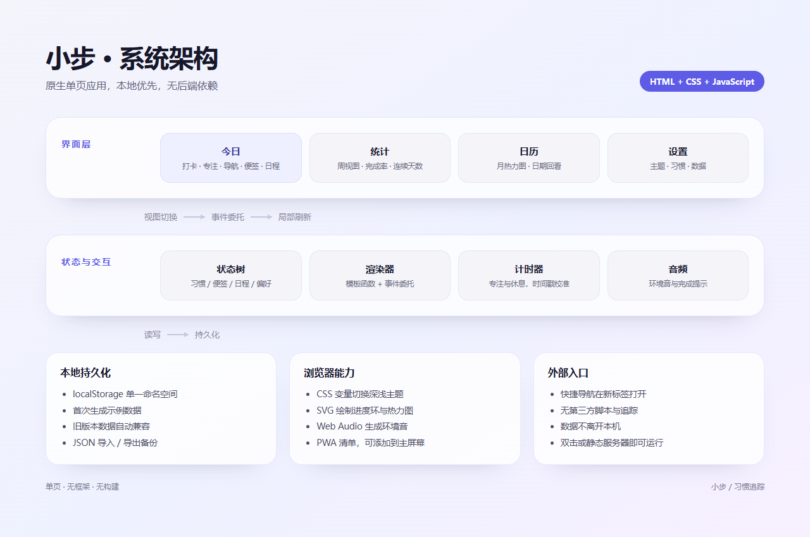

# 小步：把一天收进一个界面

## 作品背景

习惯追踪工具常见的问题不是功能太少，而是入口太多。打开一个应用，先要切到打卡页，再切到统计页，再切到设置页，注意力在页面之间被消耗，真正想做的事反而被推迟。小步从一个很具体的场景出发：大学生要在课程、作业与自我提升之间切换，自由职业者要在项目、客户与生活之间切换，他们需要的不是一套复杂的项目管理，而是一个随时能看见今天、随手能完成一件事的界面。

## 设计思路

作品围绕三个原则展开。

第一，一个界面完成大部分事情。今日页同时容纳习惯打卡、专注计时、快捷导航、闪念便签与时间块日程，用户不需要为了记一个念头或开始一次专注而离开当前页面。

第二，把入口放在需要它的地方。今日页提供统计、日历、习惯管理与新建的快捷入口；顶部时钟与问候让用户确认当下；每张卡片都能直接操作。底部保留四个主视图，切换成本低但没有强制路径。

第三，减少决策而不是增加配置。习惯只保留名称、图标、颜色与每日次数；便签只保留文本与三档优先级；日程只保留时间与标题。所有数据都能一键导出，避免被工具锁死。

## 功能详解

今日仪表盘用进度环汇总当天完成情况，并显示连续打卡天数。习惯卡片一次点击即可打卡，达到目标后再次点击可以撤销。专注卡提供 25 分钟专注、5 分钟短休与 15 分钟长休，计时与环状进度同步更新，环境音用 Web Audio 生成，适合在宿舍或咖啡馆里快速进入状态。

快捷导航把 Notion、GitHub、AI 助手、设计工具与网课放在同一块区域，点击直接在新标签打开，也可以按自己的习惯增删。闪念便签用于接住临时出现的想法，支持 P1 到 P3 的优先级和完成勾选。今日时间块把一天拆成几个可执行的段落，完成后自动淡化，帮助用户看到进度而不是堆积任务。

统计页给出本周节奏、总打卡次数、最佳连续天数与 30 天完成率，并按习惯展示完成比例。日历页用热力图呈现每天的完成度，点击任意日期可以回看当天的习惯记录。设置页负责主题、习惯管理、数据导入导出与重置。

## 技术实现

作品完全使用原生 HTML、CSS 与 JavaScript，没有框架与构建步骤，因此可以直接打开或由任意静态服务器托管。状态保存在 localStorage 中，首次打开会生成一组示例数据，之后的所有操作即时落盘。深色与浅色主题通过 CSS 变量切换，并支持跟随系统。

界面采用 iOS 风格的卡片流：大圆角、轻阴影、分组留白与底部毛玻璃标签栏。移动端全屏显示，桌面端居中为一块手机尺寸的画布，兼顾预览与演示。进度环使用 SVG 描边偏移实现，计时使用时间戳计算剩余秒数，避免后台标签页导致计时漂移。

## 数据与边界

所有数据只存在本机浏览器，不依赖后端，也不会上传。导入导出使用 JSON，便于迁移与备份。作品目前面向个人使用，不包含账号体系与多设备同步；这些能力可以在后续版本中通过云同步补齐，但不应牺牲当前的简洁性。

## 后续方向

下一步计划加入可选的云同步、习惯分组、周目标与更细的专注统计，同时保持今日页的单屏信息密度。对大学生与自由职业者来说，工具的价值不在于功能数量，而在于每天愿意打开它。